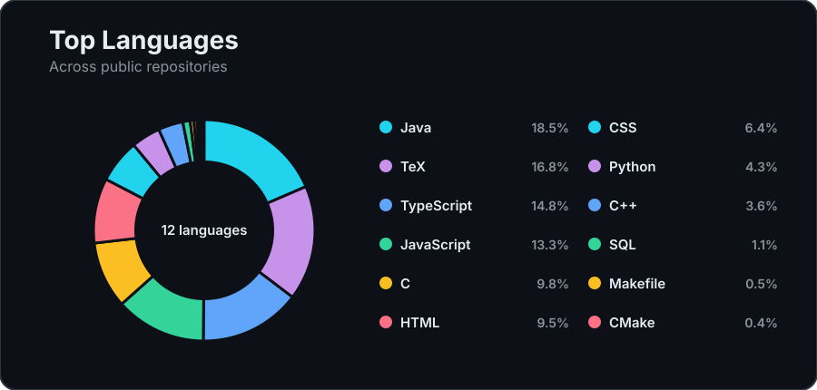

# Daniel Felipe Ramírez Vargas

Systems Engineering student at Pontificia Universidad Javeriana with experience using modern technologies to develop web and mobile applications. I am interested in data analysis, automation, operating systems, and using generative AI to turn technical information into clear decisions.

## Experience

### Academic Teaching Assistant — Pontificia Universidad Javeriana
**Introduction to Programming (C++) and Operating Systems · July 2024 — Present**

- Supported the assessment of assignments involving data collection, visualization, and analytics with consistent criteria and clear feedback.
- Guided laboratory sessions for more than 20 students, turning syntax questions into structured debugging and problem decomposition.
- Led exam-preparation sessions covering programming logic, C++, processes, memory, and system behavior.
- Explained complex technical concepts through clear examples, strengthening algorithmic reasoning, operating-systems knowledge, and performance analysis.

## Tech Stack

### Programming Languages

### Web & Mobile Development

### Data, Analytics & Automation

### Version Control & Collaboration

## GitHub Activity

  

  

## Knowledge

- **Operating systems:** processes, memory, concurrency, parallelism, and performance analysis.
- **Information systems and distributed-systems architectures.**
- **Simulation, optimization, prototyping, and usage-pattern analysis.**
- **Data visualization and communication of findings** with Python, Excel, and MATLAB.
- **Web and mobile development:** experience building applications with Angular, TypeScript, Android, Jetpack Compose, Kotlin, and Firebase; familiarity with MVVM architecture.
- **Backend and API development:** experience with Spring Boot, Node.js, PostgreSQL, REST APIs, JSON, endpoint security, Swagger, and Postman.
- **Software testing:** unit, integration, and end-to-end testing, including browser automation with Selenium.
- **Generative AI and prompt engineering** for synthesizing, analyzing, designing, and presenting structured information.
- **Communication and leadership:** technical instruction, feedback, and team coordination.
- **Languages:** native Spanish and C1 English (IELTS, January 2026).
